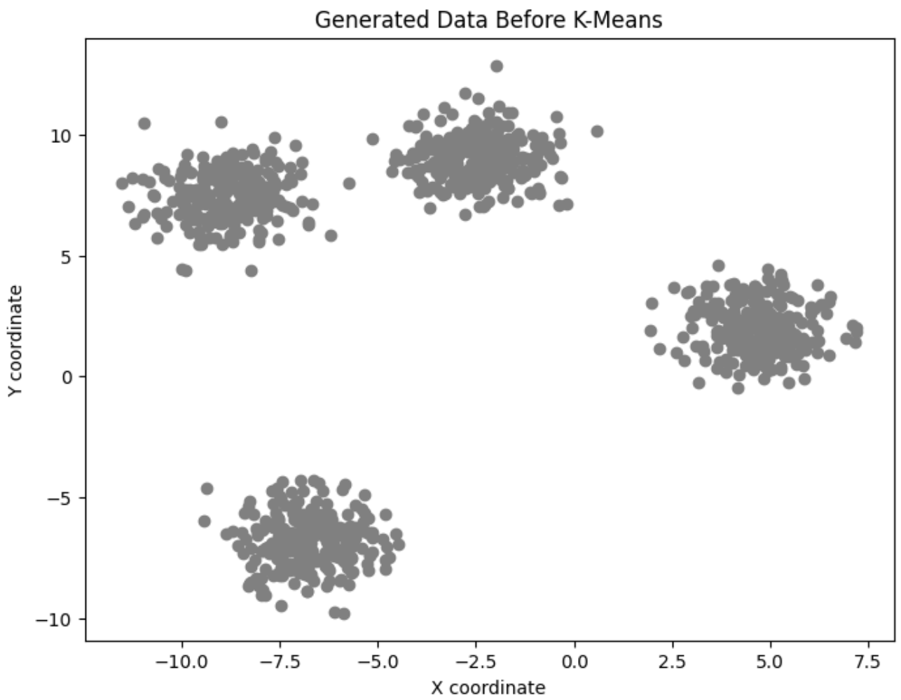
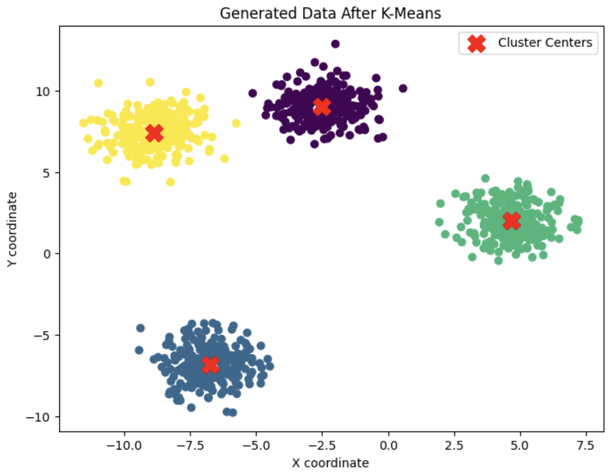
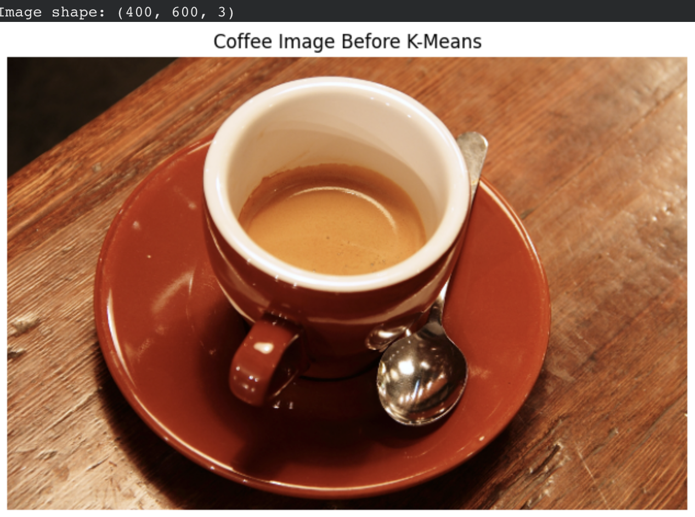
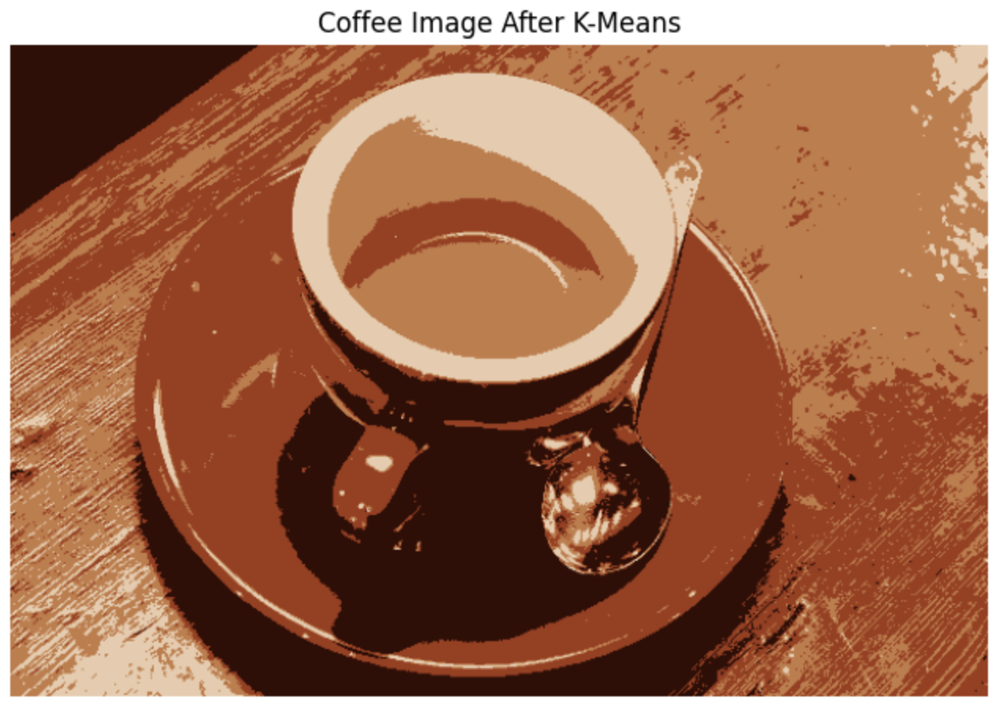
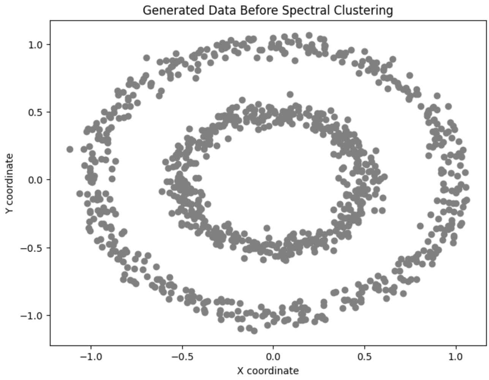
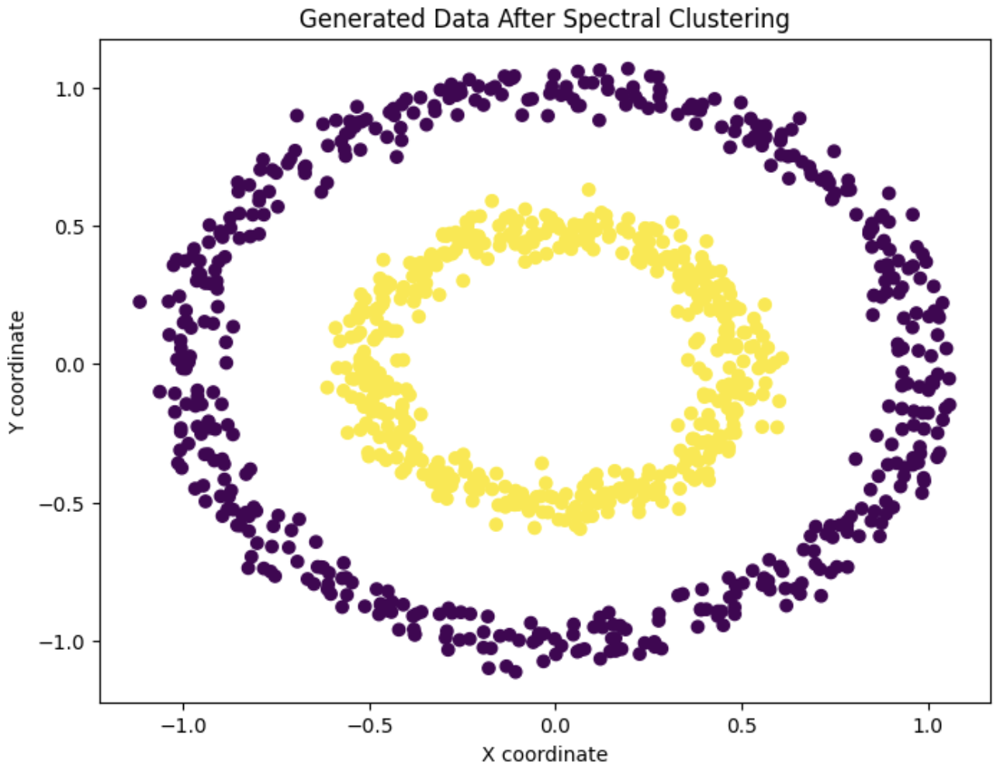
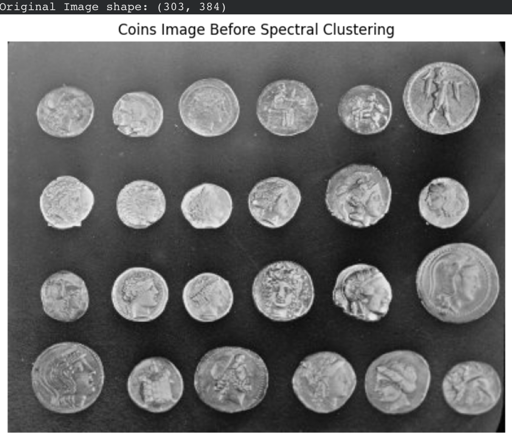
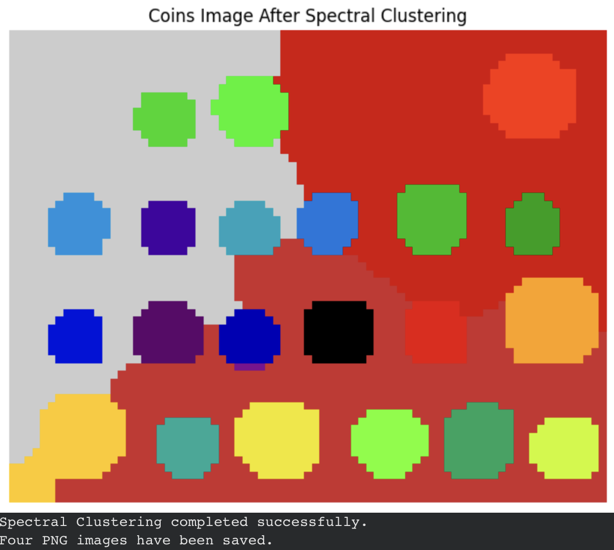

Welcome to my Computer Vision lab repository! This project explores clustering algorithms using Python, focusing on data clustering and image segmentation. Through practical experiments, I compare the results of K-Means and Spectral Clustering using visualizations of the original inputs and the resulting clusters.

Lab 1 — K-Means Clustering

K-Means is an unsupervised learning algorithm that groups data points into clusters based on their similarity. In this lab, I explore how the algorithm separates generated data and applies pixel clustering to an image.
Experiment 1: Generated Data

The following comparison shows the generated dataset before clustering and the resulting cluster assignments after applying K-Means.

  
  

  <em>Before Clustering</em> &nbsp; | &nbsp; <em>After Clustering</em>

Experiment 2: Coffee Image Segmentation

K-Means can group image pixels based on their color or intensity features. This experiment compares the original coffee image with the result after applying K-Means clustering.

  
  

  <em>Original Image</em> &nbsp; | &nbsp; <em>After Segmentation</em>

Lab 2 — Spectral Clustering

Spectral Clustering uses relationships between data points to identify groups. It is particularly useful for datasets with complex structures that may not be easily separated by conventional K-Means clustering.

Experiment 1: Generated Data

This experiment visualizes the generated dataset before Spectral Clustering and the cluster assignments produced by the algorithm.

  
  

  <em>Before Clustering</em> &nbsp; | &nbsp; <em>After Clustering</em>

Experiment 2: Coins Image Segmentation

In this experiment, Spectral Clustering is applied to a coins image to explore how pixels can be grouped into distinct regions. The comparison presents the original image and the resulting segmentation.

  
  

  <em>Original Image</em> &nbsp; | &nbsp; <em>After Segmentation</em>

Tools & Libraries

* Python — Implementing the clustering algorithms.
* NumPy — Numerical operations and data manipulation.
* Matplotlib — Visualizing datasets and clustering results.
* Scikit-learn — K-Means and Spectral Clustering implementations.
* Scikit-image — Image processing utilities, where applicable.
* Google Colab — Running and testing the experiments.

Learning Objectives

These labs aim to develop a practical understanding of clustering techniques and their role in computer vision. By implementing K-Means and Spectral Clustering, I explore how different algorithms identify patterns in data, compare their clustering performance through visual results, and examine how these methods can be applied to image segmentation.
